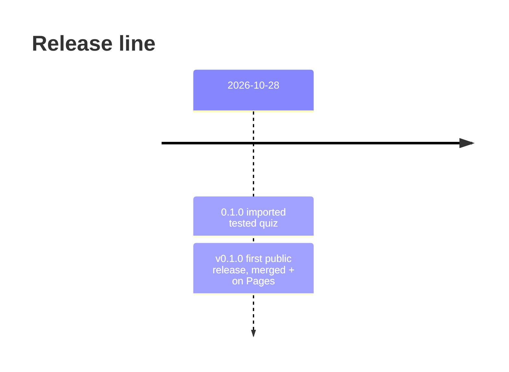
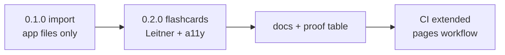

# Changelog

All notable changes to this repo. Dates are ISO. Versions are `MAJOR.MINOR.PATCH`; the app has no API, so `MINOR` marks a feature and `PATCH` a fix.

## 2026-10-28 — [RELEASE] v0.1.0 — emino

`b958a9e2` is the merge of [PR #1](https://github.com/eminogrande/flugschein-training/pull/1) into `main` and the first public release. Deploy: GitHub Pages, <https://eminogrande.github.io/flugschein-training/> (Pages workflow `.github/workflows/pages.yml`, run `40701087940` green on `b958a9e2`; tests run `40701087581` green on the same commit).

Tag `v0.1.0` targets `508c09c`, the release-metadata commit on `main` above the released code; Pages run `40701951159` and tests run `40701951076` are green there and the footer stamp `v0.1.0 · built 2026-10-28 · by emino` is live.

Released content is the 0.2.0 block below, unchanged — that block was written before the merge and never shipped separately, so it lands as part of 0.1.0:

- Quiz from the imported 90-question bank, now with a flashcard mode over it.
- Leitner scheduling (five boxes, 0 / 1 / 3 / 7 / 16 days) with reset, `localStorage` plus memory fallback.
- Keyboard control and accessibility pass on the card screen.
- Honest-scope README (starter-set limits, study plan), `DECISIONS.md`, `PROMPTLOG.md`.
- Extended test suite and the Pages workflow.

Release metadata, same commit as the docs entries below:

- App footer carries `v0.1.0 · built 2026-10-28 · by emino` — the only status surface, since a static app has no health endpoint (`index.html:149-151`).
- README status table names this version, date, author, live URL and `b958a9e2` as the deployed revision.

## 0.2.0 — 2026-10-28 — unreleased (branch `feat/flashcards-docs`)

### Added

- Flashcard mode over the existing 90 questions: question first, flip for the answer and explanation, *Again* / *Know* grading.
- Leitner scheduling in `flashcards.js` — five boxes, 0 / 1 / 3 / 7 / 16-day gaps, same-session repeat on *Again*, reset button, `localStorage` with an in-memory fallback and corrupt-state sanitising.
- Keyboard control on the card screen: <kbd>Space</kbd> flip, <kbd>1</kbd> again, <kbd>2</kbd> know, <kbd>Esc</kbd> back. Focus returns to the card after each grade.
- `test/flashcards.test.mjs` (9 scheduling unit tests) and `test/cards.smoke.test.mjs` (12 browser tests, including a quiz-still-works check).
- Shared CDP harness `test/helpers/browser.mjs`; `test/smoke.test.mjs` now uses it.
- `README.md` rewrite: status table, honest scope and study plan, Mermaid architecture and user flow with `file:line` references, file navigation, proof table.
- `DECISIONS.md` and `PROMPTLOG.md`.
- `.github/workflows/pages.yml` deploying the static root to GitHub Pages on `main`.

### Changed

- Start screen gains a flashcards block under the quiz form, with a live progress summary (`N due now · N not seen · N in boxes 4–5`).
- Schema test asserts the `flashcards.js` script tag.

### Unchanged

- Quiz flow, scoring, review, 75 % band.
- Question bank content, 90 items, ten per subject.

## 0.1.0 — 2026-10-28 — imported

Initial public import of the tested app at `e62eb815`, app files only: `index.html`, `styles.css`, `app.js`, `questions.js`, `test/schema.test.mjs`, `test/smoke.test.mjs`, `.github/workflows/test.yml`.

- 90 original syllabus-style questions across nine TCAA PPL(A) subjects, each with explanation and source.
- Quiz with subject filter, 10 / 25 / all, shuffle, instant feedback, end-of-round review.
- Node test suite; headless Chrome smoke test; CI on GitHub-hosted Ubuntu.
- No research notes, no email history, no shared git history with the private repo.

