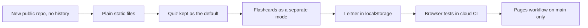

# Decisions

Short records of choices that shaped this app, with what was traded away. Read alongside [README](README.md) and [CHANGELOG](CHANGELOG.md).

## D1 — A new public repo instead of publishing the old one

**Decision:** create `eminogrande/flugschein-training` with a single import commit; do not flip the existing private `flugschein` public.

**Why:** the private repo carries research notes, email threads and dead branches across its history. Publishing it exposes correspondence that is not app content and invites readers into a messy tree.

**Cost:** two repos to keep in step. The training repo is the only one that matters for the app; the private repo keeps research.

**Rule:** the import comes from the tested tree at `e62eb815`, app files only. No research files, no email exports, no history.

## D2 — Static files, no build, no dependencies

**Decision:** `index.html`, `styles.css`, `app.js`, `questions.js`, `flashcards.js` served as-is. No bundler, no framework, no `npm install`.

**Why:** the app must open from `file://` on a phone or laptop with no network — that is the whole point for a student in a classroom or on a field. A build step adds a toolchain to break and a CI stage that proves nothing about the app.

**Cost:** no component model, manual DOM code, no type checking. Acceptable at this size.

## D3 — The quiz stays the default path

**Decision:** the start screen still leads with subject selection and *Start practice*. Flashcards sit below it in their own block.

**Why:** the quiz is the tested behaviour the app already had, and scoring a round is the honest measure. Making cards the landing page would have made a scheduling toy look like the product.

## D4 — Flashcards are a mode, not a rewrite of the quiz

**Decision:** a separate `#screen-cards` and its own state, sharing only `QUESTION_BANK`. No change to quiz scoring, review or results.

**Why:** the quiz answers "how did I do today". The cards answer "what should I see today". Bolting boxes onto the quiz loop would have muddied both.

## D5 — Leitner boxes, not SM-2

**Decision:** five boxes, gaps of 0 / 1 / 3 / 7 / 16 days. *Again* drops to box 1 and repeats the card later in the same session; *Know* promotes one box.

**Why:** Leitner is explainable in one sentence to a student and fits in ~60 lines that can be unit-tested without a browser. SM-2 needs an ease factor per card, more state and more edge cases, for a benefit that does not show up at ten cards per subject.

**Cost:** no ease adjustment for hard-but-known cards. Box 5 caps at 16 days, which is fine for an exam a few weeks out.

## D6 — `localStorage` with a memory fallback

**Decision:** schedule lives under one key, `ppl.flashcards.v1`. `pickStore` probes the store and falls back to an in-memory map when storage is blocked; reads sanitise every field and tolerate corrupt JSON.

**Why:** privacy modes and some `file://` setups throw on access. A study tool that dies on a storage exception is worse than one that forgets.

**Cost:** progress is per browser and disappears with site data. Documented in the README rather than papered over. No accounts by design.

## D7 — Browser tests in cloud CI, not local-only

**Decision:** keep `test.yml` and add a card suite against a real headless Chrome; run everything on GitHub-hosted Ubuntu.

**Why:** "works on my machine" hid a whole class of layout and focus bugs. The suites check real clicks, real key events, real reloads and 320 px overflow.

**Cost:** slower CI (~1 min) and a Chrome dependency. Both suites skip cleanly without a browser binary, so local runs stay possible.

## D8 — Pages deploys from `main` only

**Decision:** `pages.yml` triggers on `push: branches: [main]` plus manual dispatch, stages only the five app files into `_site`, and publishes with `actions/deploy-pages`.

**Why:** PRs run tests; a broken branch never reaches the live URL. Staging a whitelist keeps tests and docs out of the published artifact.

**Cost:** previewing a PR needs a local checkout. Accepted; `file://` makes that trivial.

## D9 — Honesty over a bigger-sounding claim

**Decision:** the README states that 90 questions is a starter set, that the real TCAA item count and pass mark are unverified, and that the 75 % band is a heuristic.

**Why:** a candidate who trusts "90 questions" as exam coverage will under-prepare, and the app cannot tell them so. Naming the gap is more useful than a confident tagline.
