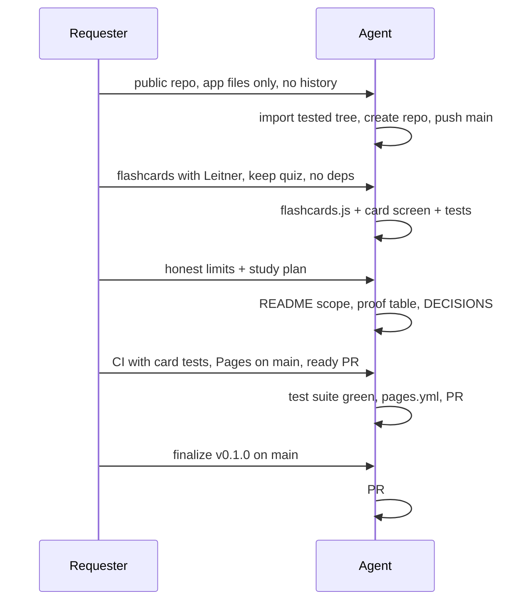

# Prompt log

What was asked for, in order, and what it changed. Kept short so a later reader can see the intent behind the tree without reading a transcript.

## 1. "Build the public app release"

> Create a public repo `eminogrande/flugschein-training`, clean initial main from the tested app only.

Result: new repo, one import commit `cfd1164` from the tested tree at `e62eb815`, app and test files only. The private `flugschein` repo stayed private; no research or email files came across, no git history was shared.

Constraint taken from the brief: do not merge, do not deploy to production. Both held.

## 2. "Add a minimal Flashcards mode using the existing 90 questions"

> Card flip, Again/Know, simple localStorage Leitner scheduling, reset, accessible keyboard use. Keep the quiz working; no backend, dependencies or accounts.

Result: `flashcards.js` holds the scheduling as pure functions; `#screen-cards` holds the UI; `app.js` owns the session and the keyboard map. Quiz code untouched. Storage falling over is handled rather than assumed away.

Judgement calls written up in [DECISIONS](DECISIONS.md): separate mode instead of merging into the quiz loop (D4), Leitner over SM-2 (D5), memory fallback (D6).

## 3. "Document honestly"

> 90 questions are enough to start but not enough alone; give a spaced-repetition + subject-quiz + mixed-mock plan; say real TCAA items and pass mark are not verified.

Result: README opens with the limit before the feature list, states that item count, format and pass mark are unverified and that 75 % is a heuristic, then gives the six-day plan with its rules. Limit section repeats it, so a skimmer still meets it.

## 4. "README must be polished" with links, Mermaid and proof

> Top links to CHANGELOG and PROMPTLOG, Mermaid architecture and user-flow charts with `file:line`, file navigation, proof table, version/date/who status. Same Mermaid treatment for DECISIONS, CHANGELOG, PROMPTLOG.

Result: all present. Every `file:line` range was read back from the files after the last edit, not guessed. The proof table names the test that backs each claim so a reader can re-run it.

## 5. "Keep/add cloud CI tests including flashcard behaviour"

Result: `test.yml` kept as-is (all branches, all PRs). Added 9 scheduling unit tests and 12 browser tests; extracted the CDP harness so both browser suites share it. Suite runs in ~7 s locally, all 40 tests green.

## 6. "Pages workflow deploying the static root on main pushes"

Result: `.github/workflows/pages.yml` — `push: branches: [main]` plus dispatch, `pages: write` and `id-token: write`, `_site` staged from the five app files with `.nojekyll`, deploy via `actions/deploy-pages`. Pages source still has to be switched to "GitHub Actions" in repo settings.

## 7. What was deliberately not done

- No merge, no production deploy, no local ZIP.
- No framework, bundler, `npm install`, account, analytics or network call.
- No change to the question bank. Ten per subject is documented as thin rather than topped up with filler.
- No claim that the questions are real exam items.

## 8. "Finalize v0.1.0 on main" — 2026-10-28 — emino

> App-only public repo, docs on main, Pages, flashcards. Finalize the release: README status, CHANGELOG `[RELEASE] v0.1.0`, PROMPTLOG, version stamp in the app, then a GitHub Release on the final main SHA. No question changes, no new features.

Decisions distilled, all shipped in the docs commit on `b958a9e2`:

- **Clean public app-only repo** — `eminogrande/flugschein-training`, import at `cfd1164`, no research files, no shared history (see [D1](DECISIONS.md)).
- **Docs live on `main`** — the `feat/flashcards-docs` branch is gone after the merge; docs are committed straight to the default branch (D10).
- **Pages is the deploy target** — `.github/workflows/pages.yml`, live at <https://eminogrande.github.io/flugschein-training/>, run `40701087940` green on `b958a9e2` (D8).
- **Flashcards stay a separate mode** over the unchanged 90 questions (D4, D5).
- **Release is v0.1.0** — first public release, no separate 0.2.0 ever shipped (D11).
- **Version visible in the app** — footer `v0.1.0 · built 2026-10-28 · by emino`, because a static app has no health endpoint (D12).

Sequence: PR [#1](https://github.com/eminogrande/flugschein-training/pull/1) merged as `b958a9e2` — docs and release metadata follow on `main` — GitHub Release `v0.1.0` targets the final `main` SHA.
