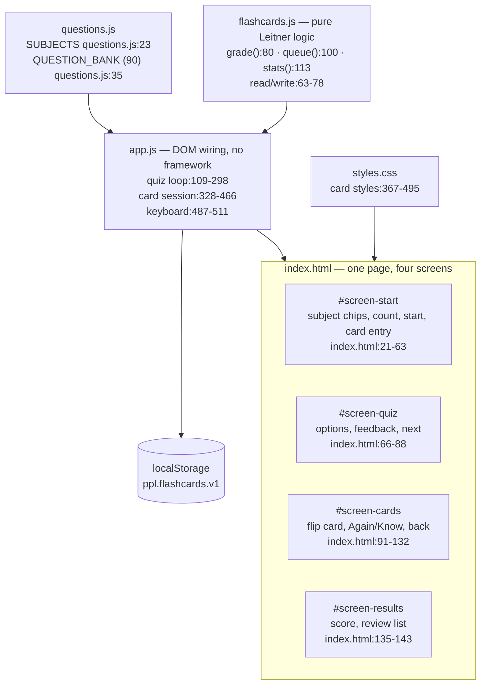
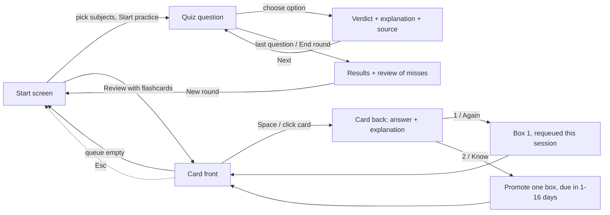

# Flugschein Training — PPL(A) theory drills

**A small, offline study app for the nine TCAA PPL(A) theory subjects: 90 original multiple-choice questions, a flashcard mode with spaced repetition, and nothing else.** No backend, no accounts, no build step, no network calls.

[CHANGELOG](CHANGELOG.md) · [PROMPTLOG](PROMPTLOG.md) · [DECISIONS](DECISIONS.md)

| | |
|---|---|
| Version | 0.1.0 — first public release |
| Date | 2026-10-28 |
| Who | Emin Mahrt ([@eminogrande](https://github.com/eminogrande)) |
| Status | Public, app-only repo. Merged to `main` via [PR #1](https://github.com/eminogrande/flugschein-training/pull/1) and deployed |
| Live | <https://eminogrande.github.io/flugschein-training/> |
| Deployed revision | `main` HEAD, published by `pages.yml` on every push. Released code merge: `b958a9e2`; release `v0.1.0` is tagged on `main` |
| Scope | Browser app + tests + docs. No research notes, no email history |

## Read this first: what 90 questions can and cannot do

The bank holds **90 questions, ten per subject**. They are written to the syllabus and to the cited regulations and textbooks. They are **not** authentic TCAA exam items, not a leaked paper, and not a large enough set to carry you through the real exams on its own.

- **Enough to start.** Ten items per subject cover the shape of each topic and give you something concrete to retrieve from on day one.
- **Not enough alone.** Ten items cannot cover a full PPL(A) subject. You will start recognising the questions instead of the material. Recognition feels like knowledge and is not.
- **Unverified against the authority.** The real TCAA item count, the format and the pass mark are **not verified** here. The 75 % band on the results screen is a study heuristic from common practice, not a confirmed TCAA threshold.
- **Not a syllabus substitute.** Work from the current TCAA PPL(A) syllabus and a current textbook; use this app to retrieve, not to learn a subject for the first time.

## Study plan that actually uses this app

Roughly 45 minutes a day, six days a week, eight to ten weeks before the exams. Adjust to your school's schedule.

| Day | What | Why |
|---|---|---|
| Daily, 10 min | Flashcards, whatever is due | Retrieval with widening gaps; misses come back the same session |
| Mon / Wed / Fri, 25 min | One subject: flashcards first, then a 10-question quiz in that subject | Subject blocks build depth without mixing cues |
| Tue / Thu, 25 min | A different subject, quiz only | Keeps the second subject warm |
| Sat, 40 min | Mixed mock: all subjects, all questions, shuffled, timed | Mixed order is what the exam does; timed runs build pace |
| After each mock | Read every explanation for every miss, then flashcard those cards | A miss is a scheduling instruction, not a score |
| Sunday | Rest, or 10 min of the weakest subject's cards | Consolidation |

Rules that matter more than the schedule:

1. **Say the answer out loud before flipping.** Reading the back first teaches nothing.
2. **Grade honestly.** "Know" means you produced it unprompted. A lucky guess is "Again".
3. **Write down misses on paper** with the page reference. The app stores scheduling, not understanding.
4. **Subject quizzes before mixed mocks.** Mixed mocks diagnose; they do not teach.
5. **Reset the cards weekly** if you are scoring under 75 % in a subject — the schedule has outrun your knowledge.
6. **Add questions yourself** when a textbook chapter is not covered. Ten per subject is thin; 30 is a working set.

## What is in the app

- **Quiz** — pick subjects, 10 / 25 / all questions, shuffle, instant verdict, explanation and source on every answer, end-of-round review of misses.
- **Flashcards** — one card at a time, question first, flip to reveal answer + explanation, then *Again* or *Know*. Leitner boxes 1–5 with 0 / 1 / 3 / 7 / 16-day gaps, stored in `localStorage`. Reset clears the schedule.
- **Keyboard** — quiz: <kbd>1</kbd>–<kbd>4</kbd> answer. Cards: <kbd>Space</kbd> flip, <kbd>1</kbd> again, <kbd>2</kbd> know, <kbd>Esc</kbd> back. Focus returns to the card after every grade.
- **Accessibility** — skip link, real buttons, `aria-expanded` on the card, polite and assertive live regions, visible focus rings, no colour-only meaning, reduced-motion support.

## Run it

```sh
open index.html                 # file:// is fine
node --test "test/*.test.mjs"   # schema, scheduling, two headless-browser suites
```

Node 22+. No `npm install`. The browser suites skip themselves when no Chrome binary is present; CI always provides one.

## Architecture



`questions.js` and `flashcards.js` are dependency-free IIFEs that also `module.exports`, so Node tests import them without a DOM. `app.js` never calls `fetch`; every asset is a sibling file, which keeps `file://` working.

## User flow



## File navigation

| Path | Role |
|---|---|
| `index.html` | Markup for start, quiz, cards, results. Loads `questions.js`, `flashcards.js`, `app.js` at the end of `body` |
| `app.js` | Quiz state machine, card session, scoring, review, keyboard handling |
| `flashcards.js` | Leitner boxes, due-date maths, queue ordering, storage read/write/sanitise |
| `questions.js` | `SUBJECTS` and the 90-item `QUESTION_BANK`, each item with explanation and source |
| `styles.css` | Phone-first styling, card and grade-button styles |
| `test/schema.test.mjs` | Bank shape, 90 items, ten per subject, HTML wiring, no remote assets |
| `test/flashcards.test.mjs` | Scheduling: promotion, lapse, queue order, corrupt and blocked storage |
| `test/cards.smoke.test.mjs` | Real browser: flip, grade, persistence, reset, keyboard, quiz intact, 320 px |
| `test/smoke.test.mjs` | Real browser: full quiz round, review, 320/375 px overflow |
| `test/helpers/browser.mjs` | Shared CDP harness, Chrome discovery, skip reason |
| `.github/workflows/test.yml` | CI: schema, scheduling and both browser suites on every push and PR |
| `.github/workflows/pages.yml` | Deploy the static root to Pages on `main` |
| `DECISIONS.md`, `CHANGELOG.md`, `PROMPTLOG.md` | Rationale, history, prompt trail |

## Proof

| Claim | Proof | Where |
|---|---|---|
| 90 items, ten per subject, schema-valid | `node --test test/schema.test.mjs` (9 tests) | `test/schema.test.mjs:30-110` |
| "Know" promotes exactly one box, capped at 5 | unit test | `test/flashcards.test.mjs:28-41` |
| "Again" returns a card to box 1, due now | unit test | `test/flashcards.test.mjs:43-49` |
| Future cards stay out, due cards come lowest-box first | unit test | `test/flashcards.test.mjs:51-60` |
| Corrupt or blocked storage degrades safely | unit tests | `test/flashcards.test.mjs:62-90` |
| Card hides its answer until flipped | browser test | `test/cards.smoke.test.mjs:36-58` |
| Space flips, 2 knows, 1 repeats, grades persist | browser test | `test/cards.smoke.test.mjs:60-120` |
| Reset clears the store and re-offers all 90 | browser test | `test/cards.smoke.test.mjs:142-158` |
| Quiz still runs, four options, scoring intact | browser test | `test/cards.smoke.test.mjs:173-187` |
| No horizontal scroll at 320 px, no console errors | browser test | `test/cards.smoke.test.mjs:189-206` |
| CI green on the merged commit `b958a9e2` | [tests run 40701087581](https://github.com/eminogrande/flugschein-training/actions/runs/40701087581) | `.github/workflows/test.yml` |

## Limits

- 90 questions, ten per subject — a starter set, see above.
- Real TCAA item count, format and pass mark unverified; 75 % is a heuristic.
- Explanations are written by hand against the cited sources and have not been reviewed by a CFI.
- Scheduling is per-browser. Clearing site data loses the boxes.
- English only. No exam timer, no analytics, no sync.

## Deploy

`.github/workflows/pages.yml` stages the five static files into `_site` and publishes them with `actions/deploy-pages` on every push to `main`. Pages must be set to **GitHub Actions** as its source (Settings → Pages → Build and deployment → Source). PRs run only the test workflow.

There is no health endpoint — the app is static. The running build identifies itself in the footer with version, build date and author (`v0.1.0 · built 2026-10-28 · by emino`, `index.html:149-151`, styling `styles.css:357-363`), which is the live status surface a reader or agent compares against this table.
